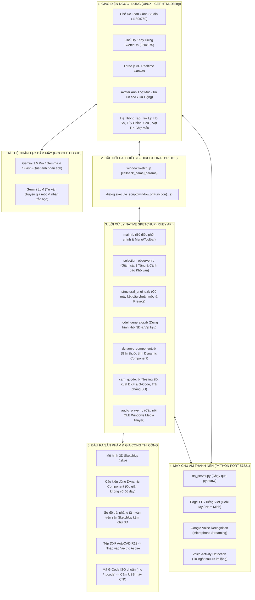
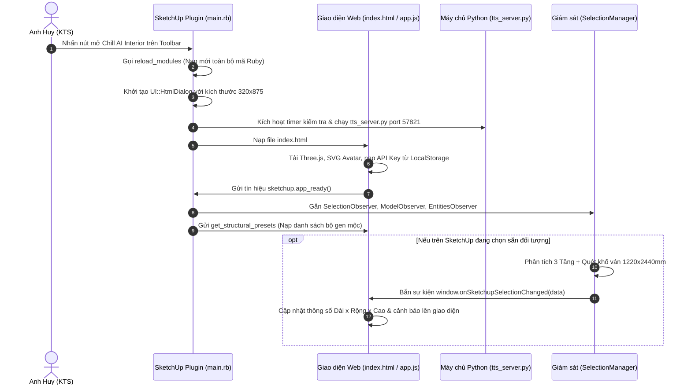

# 🏗️ TÀI LIỆU 00: TỔNG QUAN KIẾN TRÚC HỆ THỐNG & CẦU NỐI HAI CHIỀU (BRIDGE)
### Chill AI Interior - Trợ Lý Thiết Kế 3D & Sản Xuất CNC
**Tổng Công Trình Sư:** Anh Huy (The Architect)  
**Tác giả tài liệu:** Lan (Trợ lý AI đồng hành)

---

## 1. SƠ ĐỒ KIẾN TRÚC TỔNG THỂ (SYSTEM ARCHITECTURE)

Hệ thống được thiết kế theo mô hình lai (Hybrid Architecture) kết hợp giữa:
1. **Lõi Plugin Native SketchUp (Ruby API):** Điều khiển không gian 3D, dựng hình, gán Dynamic Component, theo dõi tương tác người dùng, bóc tách phôi và xuất mã gia công.
2. **Giao diện người dùng Webview Hiện đại (CEF Chromium / HTML5 / CSS3 / Three.js):** Cung cấp giao diện tương tác phong cách Game RTS HUD, hiển thị mô hình trực quan 3D song song, biểu đồ Nesting và Chatbot trợ lý ảo.
3. **Dịch vụ Âm thanh & Trí tuệ Nhân tạo Cục bộ (Local Python Audio Daemon):** Chạy ngầm tại cổng `http://127.0.0.1:57821`, đảm nhiệm Text-to-Speech (Edge TTS) và Speech-to-Text (Google Voice Streaming).
4. **Trí tuệ Nhân tạo Đám mây (Cloud AI - Google Gemini / Gemma 4):** Phân tích ảnh nội thất (Computer Vision) và xử lý ngôn ngữ tự nhiên, tư vấn chuyên môn thiết kế nội thất.

---

## 2. CƠ CHẾ DUAL-LAYOUT: CHẾ ĐỘ STUDIO & CHẾ ĐỘ KHAY ĐỨNG (DOCK TRAY)

Plugin được tối ưu cho 2 ngữ cảnh làm việc khác nhau của người thiết kế:

### a) Chế độ Khay Đứng (Dock Tray Mode - Kích thước 320 x 875 px)
* **Vị trí mặc định:** Góc phải màn hình (`left: 1208`, `top: 58`), vừa vặn hoàn hảo giữa thanh Toolbar phía trên và Status Bar phía dưới của Trimble SketchUp.
* **Mục tiêu:** Không chiếm diện tích khung nhìn 3D của SketchUp. KTS có thể vừa vẽ vừa xem thông tin bóc tách chi tiết của đối tượng đang chọn.
* **Thành phần hiển thị:**
  - Hero Top Row: Avatar Anh Thợ Mộc cử động mini và Khung trạng thái Cảnh báo Khổ Ván Real-time.
  - Phân tích 3 Tầng của chi tiết đang chọn (Kích thước Dài x Rộng x Cao, Độ dày, Diện tích m2, Chu vi dán chỉ nẹp m).
  - Nút bấm nhanh 1-chạm: "Thu về 2440mm", "Xuất DXF Aspire", "Xuất G-Code", "Trải phẳng SU".
  - Bộ điều khiển Mic giọng nói để ra lệnh bằng tiếng Việt.

### b) Chế độ Toàn Cảnh Studio (Studio RTS Full Mode - Kích thước 1180 x 750 px)
* **Vị trí:** Giữa màn hình (`left: 80`, `top: 50`).
* **Mục tiêu:** Thiết kế tập trung, quan sát mô hình 3D giả lập trên Three.js song song, chỉnh sửa thông số chuyên sâu, xem bản vẽ Nesting 2D toàn diện, duyệt kho mẫu và tra cứu vật tư.
* **Thành phần hiển thị:**
  - Viewport Three.js tương tác xoay 360 độ, bật/tắt khung dây (Wireframe), Reset Camera.
  - Floating Technical Custom Panel (nổi góc trên bên phải khung 3D).
  - Thanh Game Top Bar (Logo, Trạng thái API Key, Nút Tài khoản VIP PRO, Nút Save/Load dự án, Camera).
  - Game Bottom HUD với đầy đủ 6 Tab chức năng lớn.

---

## 3. DANH MỤC TOÀN BỘ 25 CALLBACKS HAI CHIỀU (RUBY <-> JAVASCRIPT)

Cầu nối giao tiếp được thiết lập trong `main.rb` qua `UI::HtmlDialog.add_action_callback` và gọi ngược lại giao diện qua `execute_script`:

| STT | Tên Callback (JS gọi Ruby) | Tham số đầu vào (Payload) | Hành động của Ruby và Phản hồi về JS |
| :---: | :--- | :--- | :--- |
| **1** | `create_3d_model` | JSON: `{type, length, width, height, thickness, material, leg_style, drawers, doors...}` | Gọi `ModelGenerator.generate`. Nếu là tủ áo, tự động chuyển tiếp qua `StructuralEngine`. Trả về: `window.onSketchUpModelCreated(entityID)`. |
| **2** | `create_dynamic_component` | JSON: `{entity_id, type, name, length, width, height...}` | Gọi `DynamicComponentBuilder.build_and_attach`. Chuyển đổi khối đang chọn hoặc dựng mới. Trả về: `window.onDynamicComponentCreated(entityID)`. |
| **3** | `export_gcode` | JSON: `{sheet_w, sheet_h, tool_diameter, cut_feed, ...}` | Bóc tách chi tiết, chạy thuật toán Shelf Bin-Packing, biên dịch G-Code ISO và DXF. Trả về: `window.onGCodeGenerated(resultJson)`. |
| **4** | `save_gcode_file` | JSON: `{content, filename}` | Mở `UI.savepanel` để người dùng chọn thư mục/USB lưu file `.nc` / `.gcode`. |
| **5** | `export_gcode_direct` | JSON: Tham số cấu hình dao và khổ ván | Tính Nesting tự động và mở ngay hộp thoại lưu file G-Code 1-chạm. |
| **6** | `save_dxf_file` | JSON: `{content, filename}` | Mở `UI.savepanel` lưu file `.dxf` chuẩn AutoCAD R12 cho Vectric Aspire. |
| **7** | `export_dxf_direct` | Không có / Tham số ván | Quét vùng chọn trong SketchUp, xuất thẳng file DXF 2D. Trả về: `window.onDxfExported(result)`. |
| **8** | `nest_to_sketchup` | JSON: Tham số khổ ván & dao | Trải phẳng toàn bộ các tấm ván trực tiếp lên mặt sàn SketchUp kèm chữ 3D khắc nhãn chi tiết. Trả về: `window.onNestingToSUCompleted(result)`. |
| **9** | `clamp_oversized_to_standard`| Không có | Co kích thước các tấm vượt khổ ván về tối đa 2440mm ngay trong SketchUp. |
| **10** | `zoom_to_entity` | `entity_id` | Định vị camera SketchUp xoay và zoom sát vào chi tiết được chọn. |
| **11** | `zoom_selected_entity` | `entity_id` | Zoom tiêu điểm vào đối tượng được chỉ định. |
| **12** | `get_current_selection` | Không có | Lệnh Polling từ JS yêu cầu Ruby đọc lại đối tượng đang chọn trong SketchUp. |
| **13** | `app_ready` | Không có | Bắt tay khởi động (Handshake), báo cho Ruby biết UI đã sẵn sàng tiếp nhận observer. |
| **14** | `set_window_layout_mode` | Chuỗi: `'dock_tray'` hoặc `'studio'` | Đổi kích thước cửa sổ SketchUp Dialog tương ứng (`320x875` hoặc `1180x750`). |
| **15** | `lock_dock_height` | Không có | Khóa kích thước cửa sổ khi người dùng đang ở chế độ khay đứng. |
| **16** | `clamp_dock_size` | Không có | Hỗ trợ tương thích kích thước khay đứng. |
| **17** | `reload_plugin_all` | Không có | Nạp lại toàn bộ file `.rb` bằng `load`, kết nối lại observer và reload trang HTML. |
| **18** | `get_structural_presets` | Không có | Đọc `furniture_rules.json` và trả về danh sách preset: `window.onStructuralPresetsLoaded(presets)`. |
| **19** | `build_structural_wardrobe`| JSON: `{preset_id, length, width, height, doors, drawers...}` | Dựng tủ áo chuẩn mộc CNC có đầy đủ công thức Dynamic DC từng tấm ván. |
| **20** | `save_custom_preset` | JSON: Dữ liệu thông số mộc của xưởng | Lưu vào file `furniture_rules.json` dưới mục `custom_user`. Trả về: `window.onPresetSaved(bool)`. |
| **21** | `contribute_knowledge` | JSON: `{title, author, rules, description...}` | Lưu ý kiến đóng góp kỹ thuật mộc vào `community_contributions.json`. Trả về: `window.onKnowledgeContributed(true)`. |
| **22** | `play_audio` | JSON: `{text, voice, speed, cache_id}` | Gọi Windows Media Player COM OLE để phát âm thanh MP3 mượt mà. |
| **23** | `stop_audio` | Không có | Dừng phát âm thanh ngay lập tức. |
| **24** | `ensure_tts_server` | Không có | Kiểm tra tiến trình `tts_server.py`, nếu chưa chạy thì tự động `spawn` nền. |
| **25** | `log_message` | Chuỗi văn bản | In thông báo log ra cửa sổ Ruby Console của SketchUp (`puts`). |

---

## 4. QUY TRÌNH KHỞI ĐỘNG VÀ BẮT TAY HAI CHIỀU (STARTUP HANDSHAKE)

---

## 5. CƠ CHẾ HOT-RELOAD VÀ DEBUG TỨC THÌ (ZERO-RESTART)

Hệ thống được thiết kế theo chuẩn kỷ luật Vibe Code của anh Huy:
1. **Reload Ruby không cần khởi động lại SketchUp:** Hàm `ChillAIInterior.reload_modules` tự động `load` lại toàn bộ 6 file Ruby (`selection_observer.rb`, `model_generator.rb`, `dynamic_component.rb`, `cam_gcode.rb`, `audio_player.rb`, `structural_engine.rb`).
2. **Nút Tải Lại 1-Chạm:** Trên thanh Top Bar (cả chế độ Studio lẫn Dock) đều có nút `🔄 Tải Lại`, kích hoạt callback `reload_plugin_all` -> Ruby reload module -> Reconnect Observer -> JavaScript gọi `window.location.reload(true)`.
3. **Debug độc lập trên Google Chrome:** Anh Huy có thể mở trực tiếp tệp `exam-app/sketchup-plugin/chill_ai_interior/ui/index.html` trên trình duyệt Chrome để căn chỉnh CSS/JS mà không cần mở phần mềm SketchUp nặng nề.
