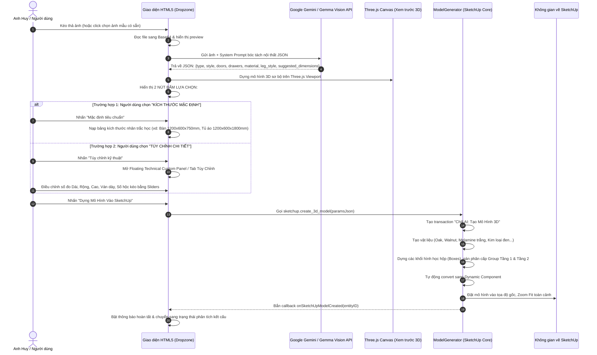

# 📸 TÀI LIỆU 01: LUỒNG QUÉT ẢNH AI VISION & DỰNG HÌNH 3D (IMAGE-TO-3D)
### Chill AI Interior - Trợ Lý Thiết Kế 3D & Sản Xuất CNC
**Tổng Công Trình Sư:** Anh Huy (The Architect)  
**Tác giả tài liệu:** Lan (Trợ lý AI đồng hành)

---

## 1. MỤC TIÊU & BỐI CẢNH NGHIỆP VỤ
Tính năng Image-to-3D cho phép Kiến trúc sư hoặc người dùng cá nhân chỉ cần chụp một bức ảnh đồ nội thất từ thực tế (hoặc tải ảnh từ Pinterest, Google, Facebook), AI sẽ:
1. Tự động nhận diện chủng loại nội thất (bàn, tủ áo, tủ bếp, kệ tivi, giường...).
2. Phân tích kết cấu: số cánh cửa, số ngăn kéo, kiểu chân (chân sắt hộp chữ U, chân gỗ cone, chân ván), vật liệu gỗ.
3. Cung cấp **2 lựa chọn kích thước trực quan**:
   - **Lựa chọn 1: Kích thước Mặc định (Standard Mode):** Tự động nạp kích thước nhân trắc học tiêu chuẩn người Việt Nam.
   - **Lựa chọn 2: Tùy chỉnh Chi tiết (Custom Mode):** Cho phép can thiệp từng thông số Dài x Rộng x Cao, độ dày ván, số cánh, ray trượt.
4. Tự động dựng mô hình 3D tỉ lệ 1:1 trực tiếp trên Trimble SketchUp với vật liệu thật.

---

## 2. SƠ ĐỒ QUY TRÌNH TOÀN DIỆN (END-TO-END FLOW)



---

## 3. CÁC ĐẦU VÀO NHẬN DIỆN (INPUT SOURCES)

Người dùng có thể cung cấp hình ảnh qua 4 phương thức khác nhau:
1. **Kéo & Thả (Drag & Drop):** Thả file ảnh (`.png`, `.jpg`, `.jpeg`, `.webp`) trực tiếp vào khung nét đứt Dropzone.
2. **Nút Tải Ảnh (File Browser):** Click để duyệt file từ máy tính.
3. **Camera Chụp Trực Tiếp:** Sử dụng webcam hoặc camera máy tính để chụp phác thảo trên giấy hoặc đồ nội thất thực tế.
4. **Thư Viện Ảnh Mẫu (Preset Sample Cards):** Các ảnh mẫu có sẵn tích hợp trên giao diện để thử nghiệm nhanh:
   - *Bàn làm việc Scandinavian:* Bàn chân sắt chữ U, 1 hộc kéo, mặt gỗ sồi.
   - *Tủ quần áo 3 cánh hiện đại:* Tủ 3 cánh mở, 2 ngăn kéo dưới, gỗ công nghiệp MDF melamine trắng.
   - *Tủ bếp module chữ I:* Bếp trên, bếp dưới, mặt đá Marble, khoang chậu rửa và bếp nấu.
   - *Kệ sách / Kệ tivi tối giản:* Kệ nhiều đợt chia đối xứng.
   - *Giường ngủ hiện đại:* Đầu giường bọc nỉ/gỗ, dát phản công nghiệp.

---

## 4. CHI TIẾT 2 CHẾ ĐỘ THIẾT LẬP KÍCH THƯỚC

### a) Chế độ 1: Kích thước Mặc định (Standard Mode)
Hệ thống nạp trực tiếp bộ số liệu chuẩn nhân trắc học đã được tối ưu cho người Việt:
* **Bàn làm việc / Bàn học:** Dài 1200mm x Rộng 600mm x Cao 750mm (Độ dày ván mặt: 18mm, chân sắt hộp 30x30mm).
* **Tủ quần áo tiêu chuẩn:** Dài 1200mm (hoặc 1600mm) x Sâu 600mm x Cao 1800mm (Độ dày thùng ván: 17.5mm, hậu 9mm, len chân 60mm).
* **Kệ sách / Kệ trang trí:** Dài 1000mm x Sâu 300mm x Cao 1600mm (Khoảng cách giữa các đợt chia: 350mm để vừa tài liệu A4).
* **Tủ bếp dưới:** Sâu 600mm x Cao 810mm (chuẩn phong thủy Lỗ Ban mặt bàn bếp).
* **Tủ bếp trên:** Sâu 350mm x Cao 700mm, cách mặt bếp dưới 600mm - 650mm.
* **Giường ngủ:** Dài 2000mm x Rộng 1600mm (hoặc 1800mm) x Cao thành giường 400mm (đầu giường 900mm).

### b) Chế độ 2: Tùy chỉnh Kỹ thuật (Technical Custom Mode)
Cung cấp bảng thông số chi tiết (cả ở Floating Panel trên màn 3D lẫn Tab Tùy Chỉnh):
* **Kích thước bao:** 3 thanh kéo trượt (Sliders) hoặc ô nhập số:
  - Chiều Dài (X): từ `400mm` đến `3000mm` (bước nhảy 10mm).
  - Chiều Rộng / Sâu (Y): từ `300mm` đến `1200mm`.
  - Chiều Cao (Z): từ `400mm` đến `3000mm`.
* **Quy cách ván công nghiệp:** Menu chọn độ dày tấm ván: `15mm` (MFC giá rẻ), `17mm` (Ba Thanh), `17.5mm` (An Cường), `18mm` (Minh Long), `25mm` hoặc `36mm` (kẹp đôi làm mặt bàn dày).
* **Cơ cấu cánh & ngăn kéo:**
  - Số lượng cánh cửa: Từ 0 đến 6 cánh (chọn cánh mở quay hoặc cánh lùa).
  - Số hộc ngăn kéo: Từ 0 đến 6 hộc tủ (tự tính chiều cao mặt ngăn kéo = `khoang_chua / so_hoc`).
* **Vật liệu hoàn thiện:**
  - Gỗ Sồi Nga (Oak Woodgrain tự nhiên)
  - Gỗ Óc Chó Bắc Mỹ (Walnut sang trọng)
  - Melamine Trắng Mờ (White Melamine)
  - MDF Lõi Xanh Chống Ẩm
* **Kiểu kết cấu chân đỡ:**
  - `metal_frame`: Khung sắt hộp sơn tĩnh điện chữ U hoặc chữ O.
  - `wooden_legs`: Chân gỗ tự nhiên vuốt cone nghiêng 10 độ phong cách Bắc Âu.
  - `panel_legs`: Chân ván gỗ công nghiệp nguyên tấm liên kết yếm chịu lực.
* **Nút "Lưu Làm Mặc Định":** Cho phép anh Huy lưu lại các thông số vừa tinh chỉnh thành bộ thông số mặc định riêng cho xưởng của mình (`localStorage: chill_ai_default_cabinet`).

---

## 5. BÓC TÁCH MÃ NGUỒN `model_generator.rb`

Khi JavaScript phát lệnh `sketchup.create_3d_model(params)`, lõi Ruby thực thi:

```ruby
# 1. Khởi tạo tác vụ an toàn, hỗ trợ Undo 1 lần duy nhất trong SketchUp
model.start_operation("Chill AI: Tạo Mô Hình 3D", true)

# 2. Điều phối thông minh: Nếu là TỦ ÁO / CABINET
# Tự động chuyển giao sang StructuralEngine để gán công thức khóa độ dày chuẩn mộc
if type == 'wardrobe' || type == 'cabinet' || type.include?('tu')
  model.abort_operation
  return StructuralEngine.build_wardrobe_structural(params)
end

# 3. Phủ vật liệu tự động (Texture / Color)
mat_wood = get_or_create_material(wood_type)
mat_metal = get_or_create_material('metal_black')

# 4. Tạo khối Group cha (Tầng 1 - Root Assembly)
main_group = entities.add_group
main_group.name = "Chill_AI_#{type.capitalize}_#{params['name']}"
main_group.set_attribute('chill_ai', 'tier', 1)
main_group.set_attribute('chill_ai', 'category', 'Nội Thất Hoàn Thiện')

# 5. Dựng hình học từng chi tiết (Tầng 2 - Sub-components)
case type
when 'desk', 'table'
  build_desk(main_group, length, width, height, thick, leg_style, drawers, wood_type)
when 'kitchen_cabinet'
  build_kitchen(main_group, length, width, height, thick, params, wood_type)
when 'shelf', 'bookshelf', 'tv_stand'
  build_shelf(main_group, length, width, height, thick, shelves, wood_type)
when 'bed'
  build_bed(main_group, length, width, height, thick, wood_type)
end

# 6. Biến đổi thành Dynamic Component và tự động Zoom tiêu điểm
dc_inst = DynamicComponentBuilder.convert_to_dynamic_component(main_group, params)
model.selection.clear
model.selection.add(dc_inst)
model.active_view.zoom(dc_inst)
model.commit_operation
```

---

## 6. DANH MỤC CÁC HÀM XỬ LÝ LIÊN QUAN TRONG MÃ NGUỒN
* `app.js` -> `setupImageDropzone()`: Bắt sự kiện kéo thả file ảnh, chuyển sang DataURL/Base64.
* `app.js` -> `callGeminiVision(base64Image)`: Gửi prompt chuyên gia nội thất lên Google Cloud Vision.
* `app.js` -> `showAISubOptions(data)`: Hiển thị 2 nút lựa chọn Mặc định vs Tùy chỉnh.
* `app.js` -> `build3DModelFromForm()`: Đóng gói toàn bộ thông số thành JSON gửi sang SketchUp Bridge.
* `main.rb` -> `dialog.add_action_callback("create_3d_model")`: Tiếp nhận JSON và khởi chạy ModelGenerator.
* `model_generator.rb` -> `build_desk()`, `build_cabinet()`, `build_kitchen()`, `build_shelf()`, `build_bed()`: Lõi dựng hình học 3D.
