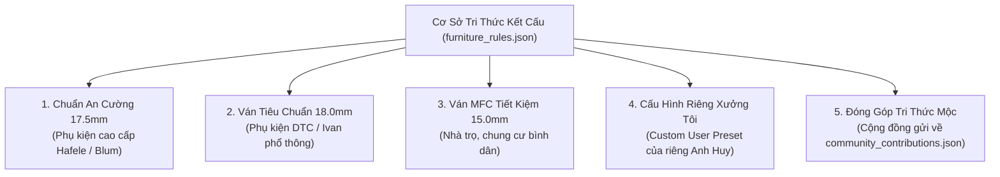
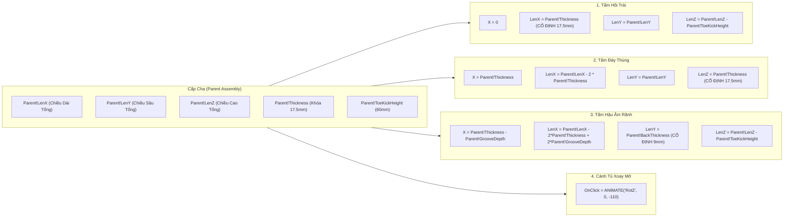

# ⚙️ TÀI LIỆU 02: CỖ MÁY KẾT CẤU CHUẨN MỘC & DYNAMIC COMPONENT THÔNG MINH
### Chill AI Interior - Trợ Lý Thiết Kế 3D & Sản Xuất CNC
**Tổng Công Trình Sư:** Anh Huy (The Architect)  
**Tác giả tài liệu:** Lan (Trợ lý AI đồng hành)

---

## 1. VẤN ĐỀ CỐT TỬ CỦA SKETCHUP & GIẢI PHÁP ĐỘT PHÁ CỦA CHILL AI

### a) Nỗi đau của thợ mộc và KTS khi dùng SketchUp truyền thống:
* Khi dùng công cụ Scale (S) hoặc Component thông thường để kéo dãn kích thước tủ áo từ 1m2 lên 1m8:
  - **Độ dày ván bị méo mó:** Tấm ván gỗ 17.5mm bị kéo dãn thành 26mm hoặc bị ép dẹp còn 11mm.
  - **Sai lệch kết cấu gia công:** Các rãnh soi hậu, khoảng hở khe cánh 2mm, độ hở ray ngăn kéo 12.7mm bị biến dạng, nạp vào máy CNC cắt sẽ **hỏng toàn bộ lô phôi**.
  - **Gán Dynamic thủ công quá cực nhọc:** Một chiếc tủ áo có 20-30 chi tiết tấm, thợ vẽ phải mất hàng giờ để gõ từng công thức toán học (`LenX`, `LenY`, `LenZ`, `_lenx_formula`...).

### b) Giải pháp của Cỗ máy Kết Cấu Chill AI (Structural Engine):
1. **Khóa cứng độ dày ván tự động:** Tủ có thể co kéo tự do từ 800mm đến 3000mm nhưng độ dày ván luôn luôn **khóa chết ở 17.5mm** (hoặc 18mm/15mm tùy theo phôi).
2. **Bộ Gen kết cấu mộc thực tế (Presets):** Tích hợp sẵn chuẩn rãnh soi hậu 9mm, khe ray bi 12.7mm, len chân 60mm.
3. **Biến đối tượng bất kỳ thành Dynamic Component 1-chạm:** Chọn bất kỳ một chiếc tủ nào có sẵn trong bản vẽ và bấm 1 nút, AI tự động phân tích và lập trình thành Dynamic Component tương tác được ngay.

---

## 2. KIẾN TRÚC BỘ GEN KẾT CẤU (FURNITURE RULES PRESETS)

Dữ liệu được lưu trữ tại `exam-app/sketchup-plugin/chill_ai_interior/knowledge_base/furniture_rules.json`. Hệ thống hỗ trợ 5 bộ quy cách sản xuất:

### Bảng so sánh thông số kỹ thuật chi tiết của các Preset:

| Thuộc tính kỹ thuật mộc | An Cường 17.5mm | Tiêu chuẩn 18.0mm | Tiết kiệm 15.0mm | Ý nghĩa gia công CNC thực tế |
| :--- | :---: | :---: | :---: | :--- |
| **Chiều dày ván thùng (`board_thickness`)** | **17.5 mm** | **18.0 mm** | **15.0 mm** | Chiều dày danh định thực tế đo bằng thước kẹp palmer |
| **Chiều dày tấm hậu (`back_thickness`)** | 9.0 mm | 9.0 mm | 6.0 mm | Ván hậu chống ẩm bảo vệ lưng tủ |
| **Chiều sâu soi rãnh hậu (`back_groove_depth`)**| 9.0 mm | 9.0 mm | 7.0 mm | Ngậm phôi ván hậu vào hồi tủ |
| **Khoảng cách soi hậu (`back_groove_offset`)**| 18.0 mm | 18.0 mm | 15.0 mm | Cách mép sau của hồi tủ để luồn chốt ke |
| **Khoảng hở ray ngăn kéo (`drawer_side_clearance`)**| **12.7 mm** | **13.0 mm** | **12.5 mm** | Khoảng cách bắt ray bi 3 tầng giảm chấn tiêu chuẩn |
| **Chiều cao len chân tủ (`toe_kick_height`)** | 60.0 mm | 60.0 mm | 50.0 mm | Chân đế cách ẩm sàn nhà |
| **Khe hở giữa 2 cánh cửa (`door_gap_center`)**| 2.0 mm | 2.0 mm | 2.0 mm | Tránh cọ quẹt khi đóng/mở cánh tủ |
| **Khoảng lùi đế chân (`toe_kick_offset`)** | 20.0 mm | 20.0 mm | 15.0 mm | Để người đứng sát tủ không bị cấn mũi chân |
| **Khoan bản lề bật (`hinge_cup_diameter`)** | Ø35 mm | Ø35 mm | Ø35 mm | Khoan chén bản lề bật Hafele/Blum chuẩn |
| **Khoan tâm bản lề (`hinge_cup_offset`)** | 22.5 mm | 22.5 mm | 21.0 mm | Khoảng cách từ mép cánh vào tâm chén bản lề |

---

## 3. CÔNG THỨC TOÁN HỌC KHÓA ĐỘ DÀY TRONG DYNAMIC COMPONENT

Trong `structural_engine.rb`, từng tấm ván thành phần được lập trình công thức ràng buộc kích thước (`_lenx_formula`, `_leny_formula`, `_lenz_formula`) và vị trí tọa độ (`_x_formula`, `_y_formula`, `_z_formula`):

### Công thức chi tiết của các tấm ván chính:
1. **Tấm Hồi Trái (Left Side Panel):**
   - Vị trí: `X = 0`, `Y = 0`, `Z = Parent!ToeKickHeight`
   - Kích thước: `LenX = Parent!Thickness`, `LenY = Parent!LenY`, `LenZ = Parent!LenZ - Parent!ToeKickHeight`
2. **Tấm Hồi Phải (Right Side Panel):**
   - Vị trí: `X = Parent!LenX - Parent!Thickness`, `Y = 0`, `Z = Parent!ToeKickHeight`
   - Kích thước: `LenX = Parent!Thickness`, `LenY = Parent!LenY`, `LenZ = Parent!LenZ - Parent!ToeKickHeight`
3. **Tấm Đáy (Bottom Panel):**
   - Vị trí: `X = Parent!Thickness`, `Y = 0`, `Z = Parent!ToeKickHeight`
   - Kích thước: `LenX = Parent!LenX - (2 * Parent!Thickness)`, `LenY = Parent!LenY`, `LenZ = Parent!Thickness`
4. **Tấm Nóc (Top Panel):**
   - Vị trí: `X = Parent!Thickness`, `Y = 0`, `Z = Parent!LenZ - Parent!Thickness`
   - Kích thước: `LenX = Parent!LenX - (2 * Parent!Thickness)`, `LenY = Parent!LenY`, `LenZ = Parent!Thickness`
5. **Tấm Hậu (Back Panel):**
   - Thụt vào một khoảng rãnh soi: `Y = Parent!GrooveOffset`
   - Vị trí X ăn sâu vào 2 bên hồi: `X = Parent!Thickness - Parent!GrooveDepth`
   - Kích thước phủ bì rãnh soi: `LenX = Parent!LenX - (2 * Parent!Thickness) + (2 * Parent!GrooveDepth)`
   - Độ dày cố định: `LenY = Parent!BackThickness` (chuẩn 9mm).

---

## 4. TÍNH NĂNG TƯƠNG TÁC ONCLICK: MỞ CÁNH & KÉO NGĂN KÉO

Khi người dùng kích hoạt công cụ **Interact (Bàn tay chỉ ngón)** trong SketchUp và click chuột vào mô hình tủ áo Chill AI:
* **Click vào Cánh Trái:** Kích hoạt hàm `ANIMATE("RotZ", 0, -110)` -> Cánh tự động mở xoay góc 110 độ ra ngoài để lộ khoang trong.
* **Click vào Cánh Phải:** Kích hoạt hàm `ANIMATE("RotZ", 0, 110)` -> Cánh tự động mở xoay đối xứng.
* **Click vào Hộc Ngăn Kéo:** Kích hoạt hàm `ANIMATE("Y", 0, -(Parent!LenY * 0.75))` -> Hộc kéo tự động trượt ra 75% chiều sâu như ray bi giảm chấn thật.
* **Click lần nữa:** Các cánh và ngăn kéo tự động đóng êm ái về vị trí ban đầu.

---

## 5. TÍNH NĂNG 1-CHẠM: BIẾN ĐỐI TƯỢNG BẤT KỲ THÀNH DYNAMIC COMPONENT

Module `DynamicComponentBuilder.convert_to_dynamic_component(target, params)` cho phép:
1. Người dùng vẽ một khối hộp hoặc import một file `.skp` bất kỳ trên mạng về.
2. Chọn đối tượng trong SketchUp và nhấn nút **"Biến Thành Dynamic DC"** trên giao diện Chill AI.
3. Hệ thống tự động:
   - Chuyển đổi Group thành `ComponentInstance` và gọi `make_unique`.
   - Đọc kích thước bao thực tế và gán dictionary `dynamic_attributes`.
   - Cung cấp các ô nhập thông số Dài, Rộng, Cao trong hộp thoại **Component Options** của SketchUp với đơn vị Millimeters.
   - Nhúng công thức tự động kiểm tra khổ ván:
     `IF(OR(LenX>96.06, LenY>96.06, LenZ>96.06), "⚠️ CẢNH BÁO: QUÁ KHỔ VÁN 2440MM!", "✅ ĐẠT CHUẨN CNC (1220x2440mm)")`
   - Kích hoạt `$dc_observers.redraw_with_undo(instance)` để SketchUp biên dịch lại đối tượng tức thì mà không cần đóng mở lại file.
