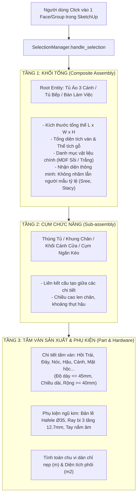
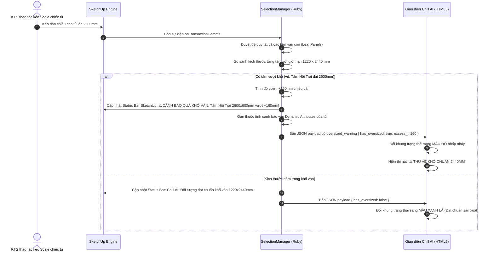

# 📐 TÀI LIỆU 03: GIÁM SÁT ĐỐI TƯỢNG 3 TẦNG & CẢNH BÁO QUÁ KHỔ VÁN REAL-TIME
### Chill AI Interior - Trợ Lý Thiết Kế 3D & Sản Xuất CNC
**Tổng Công Trình Sư:** Anh Huy (The Architect)  
**Tác giả tài liệu:** Lan (Trợ lý AI đồng hành)

---

## 1. MỤC TIÊU & TẦM QUAN TRỌNG KỸ THUẬT
Trong quá trình thiết kế nội thất trên Trimble SketchUp, rủi ro lớn nhất của KTS là:
1. **Thiết kế vượt khổ ván công nghiệp:** Khổ ván MDF/MFC chuẩn nhập khẩu tại Việt Nam (An Cường, Ba Thanh, Minh Long...) là **1220 x 2440 mm**. Nếu KTS vô tình kéo tủ cao 2600mm hoặc tấm cánh cửa dài 2500mm, khi đem file đi cắt CNC sẽ **không thể cắt được nguyên tấm**, buộc phải cắt chắp vá nối ván, gây mất thẩm mỹ và tranh cãi với chủ nhà.
2. **Click nhầm đối tượng con bị mất ngữ cảnh:** Người dùng click vào tay nắm hoặc 1 mặt cánh nhỏ, phần mềm thông thường sẽ không biết chiếc tủ tổng thể là gì.

Module `SelectionManager` (`selection_observer.rb`) của Chill AI giải quyết triệt để 2 bài toán này bằng cơ chế **Giám sát 3 Tầng** và **Quét cảnh báo quá khổ ván theo thời gian thực (Real-time Detection)**.

---

## 2. KIẾN TRÚC GIÁM SÁT ĐỐI TƯỢNG 3 TẦNG (3-TIER HIERARCHY)

Khi người dùng click chuột vào bất kỳ vị trí nào trên mô hình 3D trong SketchUp, thuật toán `find_root_entity` và `analyze_entity` sẽ phân tích sâu cây đối tượng:



---

## 3. THUẬT TOÁN QUÉT CẢNH BÁO QUÁ KHỔ VÁN THEO THỜI GIAN THỰC (REAL-TIME OVERSIZED DETECTION)

Hệ thống tích hợp 4 Observers native trong SketchUp:
1. `InternalSelectionObserver`: Bắt sự kiện khi click chọn đối tượng (`onSelectionBulkChange`).
2. `InternalModelObserver`: Bắt sự kiện khi người dùng vừa thực hiện lệnh Scale, Move hoặc Edit (`onTransactionCommit`, `onTransactionUndo`, `onTransactionRedo`).
3. `InternalEntitiesObserver`: Bắt sự kiện chỉnh sửa hình học (`onElementModified`) có cơ chế giảm tải (Throttle/Debounce 0.18s) để không gây lag phần mềm.
4. `InternalAppObserver`: Tự động kết nối lại khi mở file SketchUp mới (`onOpenModel`, `onNewModel`).



---

## 4. TÍNH NĂNG 1-CHẠM: "THU VỀ KHỔ VÁN TIÊU CHUẨN 2440MM" (`clamp_to_standard`)

Khi phát hiện chiếc tủ hoặc tấm ván vượt khổ, người dùng không cần phải đo đạc và scale thủ công:
1. Nhấn nút **"📐 Thu về khổ chuẩn 2440mm"** trên thanh Dock Header của Chill AI.
2. JavaScript gửi callback `sketchup.clamp_oversized_to_standard()`.
3. Ruby tính toán tỷ lệ co trục $Z$ (hoặc trục $X$ tương ứng):
   $$\text{scale\_factor} = \frac{2440.0}{\text{current\_dimension\_mm}}$$
4. Áp dụng phép biến đổi không gian `Geom::Transformation.scaling` trực tiếp lên đối tượng trong SketchUp.
5. Chiếc tủ tự động hạ chiều cao chính xác về $2440\text{ mm}$, đưa toàn bộ tấm ván trở lại trạng thái an toàn để gia công CNC.

---

## 5. CÁC CHỈ SỐ KỸ THUẬT TỰ ĐỘNG BÓC TÁCH (PRODUCTION METRICS)

Mỗi khi chọn một chi tiết trong mô hình, hệ thống lập tức xuất ra các thông số sản xuất chính xác:
* **Kích thước 3 chiều (Dài x Rộng x Dày):** Đơn vị milimet chính xác đến 0.1mm.
* **Diện tích bề mặt phôi ($m^2$):**
  $$\text{Diện tích } (m^2) = \frac{\text{Dài} \times \text{Rộng}}{1\,000\,000}$$
* **Thể tích ván gỗ ($m^3$):** Phục vụ tính toán khối lượng vật tư và trọng tải vận chuyển:
  $$\text{Thể tích } (m^3) = \frac{\text{Dài} \times \text{Rộng} \times \text{Dày}}{1\,000\,000\,000}$$
* **Chu vi dán chỉ nẹp cạnh ($m$):** Tính toán mét dài chỉ nẹp PVC/Veneer cần dùng cho máy dán cạnh tự động:
  $$\text{Chu vi dán cạnh } (m) = \frac{2 \times (\text{Dài} + \text{Rộng})}{1000}$$

---

## 6. TÍNH NĂNG ZOOM TIÊU ĐIỂM CHI TIẾT (`zoom_to_entity`)

* Khi KTS xem danh sách các tấm ván trên giao diện Chill AI và click vào bất kỳ tấm nào (ví dụ: *Tấm Đáy*, *Đợt Ngang 2*, *Cánh Tủ Trái*):
* Giao diện gửi `sketchup.zoom_to_entity(entity_id)`.
* Ruby lấy bounding box của chi tiết đó và điều khiển camera SketchUp:
  ```ruby
  target = model.find_entity_by_id(entity_id)
  if target && target.valid?
    model.selection.clear
    model.selection.add(target)
    model.active_view.zoom(target)
  end
  ```
* Góc nhìn trong SketchUp lập tức phóng to và căn chính giữa chi tiết được chọn, giúp KTS kiểm tra mộng ghép và đường chỉ dán cạnh mà không cần xoay chuột thủ công.
