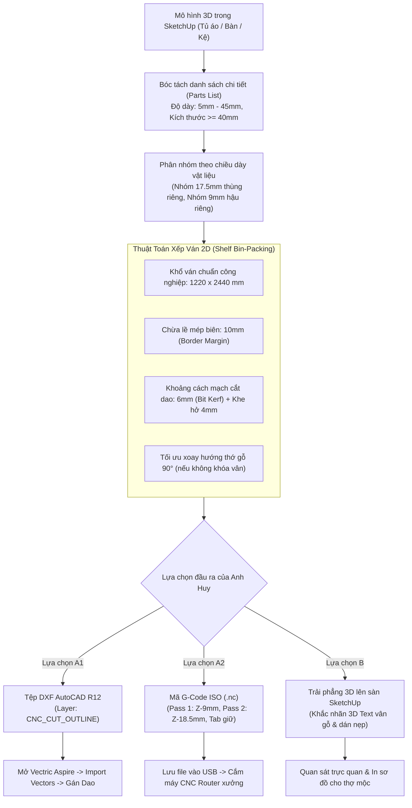

# 🏭 TÀI LIỆU 04: BÓC TÁCH TẤM NESTING 2D, XUẤT DXF ASPIRE & G-CODE CNC
### Chill AI Interior - Trợ Lý Thiết Kế 3D & Sản Xuất CNC
**Tổng Công Trình Sư:** Anh Huy (The Architect)  
**Tác giả tài liệu:** Lan (Trợ lý AI đồng hành)

---

## 1. MỤC TIÊU SẢN XUẤT & ĐẦU RA THI CÔNG (CAM & CNC)
Một mô hình 3D đẹp đến đâu nhưng nếu không thể bóc tách ra file sản xuất cho xưởng mộc thì chỉ là "bản vẽ trên giấy". Module CAM (`cam_gcode.rb`) của Chill AI hoàn thiện mắt xích cuối cùng: **Từ bản vẽ 3D trên SketchUp chuyển thẳng thành file gia công cho máy cắt phay CNC Router**.

Hệ thống cung cấp **3 LỰA CHỌN ĐẦU RA LINH HOẠT**:
1. **Lựa chọn A1 (Khuyên dùng cho xưởng chuyên nghiệp):** Xuất tệp DXF AutoCAD R12 chuẩn layer cho phần mềm **Vectric Aspire** (theo chuẩn video Kiếm Thu CNC & ABF).
2. **Lựa chọn A2 (Nhanh gọn):** Xuất thẳng mã lệnh **G-Code ISO tiêu chuẩn (.nc / .gcode)** để cắm trực tiếp USB vào máy CNC.
3. **Lựa chọn B (Trực quan tại chỗ):** Trải phẳng sơ đồ ván Nesting **ngay trên mặt bàn SketchUp** với nhãn chữ 3D (phong cách One Click Cabinet).

---

## 2. QUY TRÌNH BÓC TÁCH VÀ XẾP VÁN 2D (SHELF BIN-PACKING)



---

## 3. THÔNG SỐ CẤU HÌNH GIA CÔNG MẶC ĐỊNH (`DEFAULT_CONFIG`)

Được lưu trữ trong `cam_gcode.rb`:

```ruby
DEFAULT_CONFIG = {
  sheet_w: 1220.0,            # Chiều rộng khổ ván tiêu chuẩn (mm)
  sheet_h: 2440.0,            # Chiều dài khổ ván tiêu chuẩn (mm)
  edge_margin: 10.0,          # Chừa lề mép biên hút chân không (mm)
  tool_diameter: 6.0,         # Đường kính dao phay ngón (mm)
  part_gap: 4.0,              # Khoảng hở an toàn giữa 2 phôi (mm)
  cut_feed: 2400.0,           # Tốc độ tiến dao cắt F2400 (mm/phút)
  plunge_feed: 700.0,         # Tốc độ đâm dao trục Z F700 (mm/phút)
  spindle_speed: 18000,       # Tốc độ quay củ đục Spindle 18.000 vòng/phút
  safe_z: 15.0,               # Cao độ an toàn lùi dao Z+15mm
  pass_depth: 6.0,            # Chiều sâu cắt mỗi lớp phay
  overcut: 0.5,               # Ăn quá đáy 0.5mm vào tấm lót MDF sàn
  tab_height: 3.0,            # Chiều cao mấu cầu nối giữ tấm (Bridge Tabs)
  use_tabs: true,             # Bật mấu giữ phôi tránh bay tấm nhỏ
  allow_rotation: true,       # Cho phép tự động xoay tấm 90 độ để tiết kiệm ván
  pause_between_sheets: true  # Tạm dừng thay phôi giữa các tấm
}.freeze
```

---

## 4. CHI TIẾT 3 ĐẦU RA SẢN XUẤT

### a) Lựa chọn A1: Xuất file DXF AutoCAD R12 cho Vectric Aspire
* **Mục đích:** Đây là luồng tiêu chuẩn ngành gỗ công nghiệp. Vectric Aspire là phần mềm chuyên dụng để tạo đường dao (Toolpath Profile / Pocket / Drilling).
* **Quy cách file DXF:**
  - Định dạng chuẩn **AutoCAD R12 ASCII DXF** (tương thích 100% với tất cả phiên bản Aspire từ v8.5, v9.5, v10.5 đến v12).
  - Tách layer độc lập:
    * Layer `CNC_CUT_OUTLINE` (Màu đỏ Red): Toàn bộ đường bao chu vi kín `POLYLINE` của các tấm ván.
    * Layer `SHEET_BORDER` (Màu xanh Blue): Khung bao khổ ván $1220 \times 2440$mm để định vị gốc tọa độ $(X0, Y0)$.
    * Layer `TEXT_LABEL`: Nhãn tên chi tiết, kích thước.
* **Thao tác tại xưởng:**
  1. Bấm **"Xuất DXF 2D"** trên Toolbar SketchUp hoặc giao diện Chill AI.
  2. Mở Vectric Aspire -> Menu `File` -> `Import` -> `Import Vectors...` -> Chọn file DXF vừa lưu.
  3. Chọn tất cả vector trên layer `CNC_CUT_OUTLINE` -> Gán dao phay Ø6mm -> Tính toán đường chạy dao -> Xuất mã máy.

### b) Lựa chọn A2: Xuất trực tiếp mã G-Code ISO (.nc / .gcode)
* **Mục đích:** Dành cho người vận hành muốn cắt ngay mà không cần cài đặt thêm phần mềm CAM.
* **Cấu trúc mã G-Code an toàn:**
  - **Khởi động an toàn:**
    ```gcode
    (CHILL AI INTERIOR - G-CODE GENERATOR)
    (SHEET: 1220x2440mm | TOOL: 6mm)
    G90 G21 G17 G80 G49 G40
    M03 S18000
    G00 Z15.000
    ```
  - **Chiến lược cắt 2 Pass (Two-Pass Pocketing):**
    * Pass 1: Phay phá 1/2 chiều dày ván ($Z-9.0\text{mm}$, tốc độ $F2400$).
    * Pass 2: Phay đứt hoàn toàn phôi ($Z-18.5\text{mm}$, ăn xuống tấm lót $0.5\text{mm}$ để mép ván không bị xơ).
  - **Mấu giữ phôi (Tabs):** Giữ lại mấu cao $3\text{mm}$ tại các cạnh tấm nhỏ để lực hút chân không không làm văng phôi khi đứt đường cắt.
  - **Kết thúc hành trình:** Nhấc dao $Z+50\text{mm}$, tắt trục chính `M05`, về gốc chờ phôi `G00 X0 Y0`, kết thúc chương trình `M30`.

### c) Lựa chọn B: Trải phẳng Nesting trực tiếp lên sàn SketchUp (One Click Style)
* **Mục đích:** Thợ mộc và KTS có thể xem trực quan ngay trong không gian 3D của SketchUp xem từng tấm ván được cắt ra từ đâu, vân gỗ quay chiều nào.
* **Cách thức thể hiện:**
  - Tự động tìm khoảng trống trên sàn SketchUp (cách mô hình chính $600\text{mm}$) và vẽ mặt bàn phẳng $1220 \times 2440\text{mm}$ màu trắng ngà.
  - Xếp từng chi tiết tấm ván với độ dày thực tế ($17.5\text{mm}$) đặt gọn gàng lên mặt bàn.
  - **Khắc chữ 3D nổi (`3D Text`):**
    ```text
    Hồi Tủ Trái
    1800 x 580 x 17.5mm • XOAY 90°
    [↕ Vân Dọc • Nẹp: 2D 1R]
    ```
  - Thợ gia công chỉ cần nhìn vào hình vẽ 3D là biết ngay: cạnh nào cần dán chỉ nẹp (2 cạnh Dài, 1 cạnh Rộng) và chiều thớ gỗ chạy dọc theo phương nào.

---

## 5. CÁC CHỈ SỐ BÁO CÁO HIỆU SUẤT TẬN DỤNG VÁN
Mỗi lần chạy thuật toán Nesting, hệ thống tự động xuất bảng tóm tắt:
* **Tỉ lệ tận dụng ván (`utilization` %):**
  $$\text{Hiệu suất (\%)} = \frac{\sum \text{Diện tích chi tiết cắt}}{\text{Số tấm ván} \times (1220 \times 2440)} \times 100\%$$
  *(Thông thường đạt từ 85% đến 93% là mức tối ưu cao).*
* **Tổng chiều dài mạch cắt (`total_perimeter_m`):** Mét dài dao chạy để tính toán độ mòn lưỡi dao.
* **Thời gian gia công ước tính (`estimated_time_min`):**
  $$\text{Thời gian (phút)} = \frac{\text{Tổng chiều dài mạch cắt}}{\text{Tốc độ cắt } F2400} + (\text{Số chi tiết} \times 0.35\text{ phút đâm/nhấc dao})$$
