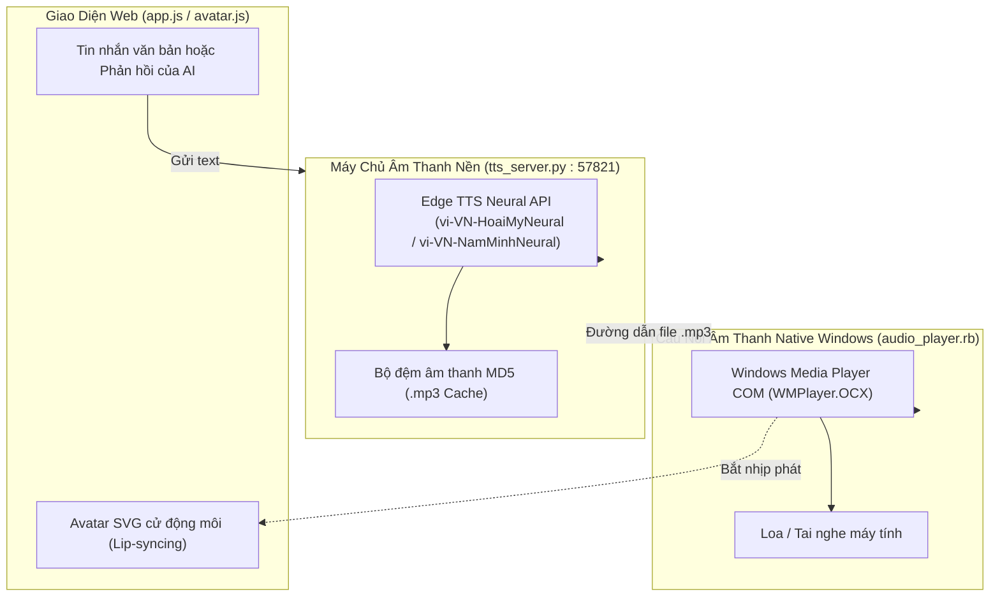

# 🎙️ TÀI LIỆU 05: TRỢ LÝ ẢO ANH THỢ MỘC (TIN TIN AI), VOICE TTS & STT REALTIME
### Chill AI Interior - Trợ Lý Thiết Kế 3D & Sản Xuất CNC
**Tổng Công Trình Sư:** Anh Huy (The Architect)  
**Tác giả tài liệu:** Lan (Trợ lý AI đồng hành)

---

## 1. MỤC TIÊU & TRẢI NGHIỆM ĐỒNG HÀNH (AI COMPANION)
Khác với các plugin thông thường chỉ có những bảng nút bấm khô khan, Chill AI Interior mang tới một **Trợ lý ảo 2D thông minh - Anh Thợ Mộc (Tin Tin AI)**:
1. Đóng vai trò như một người thợ mộc già dặn kinh nghiệm, hỗ trợ anh Huy từ khâu tư vấn kích thước Lỗ Ban, phong thủy, chọn phụ kiện cho đến việc điều khiển trực tiếp SketchUp.
2. Giao tiếp hoàn toàn bằng **Giọng nói Tiếng Việt 2 chiều**: Anh Huy nói vào micro -> AI nghe hiểu theo thời gian thực -> AI suy luận và cất giọng trả lời bằng tiếng Việt truyền cảm.

---

## 2. GIẢI PHÁP ĐỘT PHÁ VƯỢT RÀO CẢN CEF SKETCHUP AUDIO

### Vấn đề nan giải:
Cửa sổ `UI::HtmlDialog` của Trimble SketchUp sử dụng Chromium Embedded Framework (CEF). Do vấn đề bản quyền thương mại, CEF trong SketchUp **bị tước bỏ bộ giải mã MP3/AAC**, khiến thẻ `<audio>` hoặc Web Audio API của trình duyệt bị **câm tiếng 100%**.

### Giải pháp bản địa của Chill AI:
Hệ thống thiết kế Cầu nối âm thanh bản địa Windows (`audio_player.rb`) kết hợp với Máy chủ Python cục bộ (`tts_server.py`):
* Sử dụng đối tượng COM `WIN32OLE.new('WMPlayer.OCX')` chạy trực tiếp trên tầng hệ điều hành Windows.
* Âm thanh được phát độc lập với CEF, âm lượng 100%, chất lượng Stereo và độ trễ gần như bằng 0.

---

## 3. CHI TIẾT MÁY CHỦ ÂM THANH PYTHON (`tts_server.py` - CỔNG 57821)

Máy chủ được nạp ngầm bằng lệnh `spawn` với `pythonw.exe` (không hiện cửa sổ màu đen làm phiền người dùng), cung cấp 4 endpoint RESTful:

### a) `GET /ping`
* Kiểm tra trạng thái máy chủ xem đã sẵn sàng chưa (Healthcheck). Nếu chưa bật, `AudioPlayer.ensure_tts_server` trong Ruby sẽ tự khởi chạy lại sau 0.4 giây.

### b) `GET /tts?text=...&voice=...&speed=...`
* **Giọng đọc tự nhiên cao cấp:**
  - Nữ: `vi-VN-HoaiMyNeural` (Giọng cô gái miền Bắc thanh thoát).
  - Nam: `vi-VN-NamMinhNeural` (Giọng nam trầm ấm, thợ mộc từng trải).
* **Tự động điều chỉnh tốc độ & cao độ:** Tăng tốc $15\%$ (`rate: +15%`) để phản xạ đàm thoại nhanh nhẹn, không gây cảm giác ê a.
* **Bộ nhớ đệm thông minh (MD5 Audio Caching):** Những câu chào hỏi, thông báo lỗi hoặc câu nói lặp lại sẽ được lưu sẵn trong thư mục tạm `Temp/chill_tts_cache/`. Lần gọi sau phát ngay sau **0.03 giây** mà không tốn băng thông Internet.

### c) `GET /stt/start` & `GET /stt/stop` (Nhận diện giọng nói tiếng Việt)
* Sử dụng thư viện `sounddevice` kết nối trực tiếp với Microphone ở chuẩn $16.000\text{ Hz}$, $16\text{ bit}$ Mono.
* Chuyển đổi âm thanh và gửi tới Google Speech Recognition tiếng Việt (`vi-VN`).
* **Live Streaming Audio:** Vừa nói chữ vừa hiện lên màn hình chat theo thời gian thực nhờ tiến trình `_interim_worker`.
* **Cơ chế VAD (Voice Activity Detection):**
  - Tính năng tự động phát hiện khoảng lặng (`silence_time`).
  - Khi anh Huy dừng nói quá **4.0 giây**, máy chủ tự động ngắt micro, chốt nội dung văn bản và kích hoạt lệnh gửi tin nhắn. Anh Huy hoàn toàn rảnh tay, không phải cúi xuống bấm nút dừng.
* **Lọc tạp âm & Tránh lặp tiếng:** Tự động khóa Microphone khi loa đang phát tiếng của AI, tránh trường hợp AI nghe lại tiếng của chính mình gây lặp vòng lặp vô tận.

---

## 4. AVATAR SVG TƯƠNG TÁC & HOẠT HỌA CỬ ĐỘNG (LIP-SYNCING)

Trong `avatar.js`, nhân vật Anh Thợ Mộc Tin Tin được vẽ bằng đồ họa vector SVG phẳng siêu nhẹ:
* **Khung mặt & Cổ dài (`avatar-head-group`):** Lắc lư nhẹ nhàng theo phương ngang khi nói chuyện.
* **Đôi mắt (`wc3-eyes`):** Tự động chớp mắt ngẫu nhiên sau mỗi $3 - 5$ giây tạo cảm giác sống động.
* **Khuôn miệng đa trạng thái:**
  - `mouth-closed`: Trạng thái ngậm miệng khi đang lắng nghe.
  - `mouth-open-mid`: Mở vừa khi phát âm các nguyên âm hẹp (i, e).
  - `mouth-open-wide`: Há rộng khi phát âm các nguyên âm lớn (a, o, u).
  - Biên độ nhấp nháy môi được đồng bộ theo biên độ năng lượng RMS của giọng nói.
* **Chế độ AOE Mode:** Hỗ trợ chuyển đổi giữa khuôn mặt nhân vật và icon huy hiệu đối tượng kỹ thuật phong cách game chiến thuật cổ điển.

---

## 5. KHẢ NĂNG TƯ VẤN & RA LỆNH BẰNG GIỌNG NÓI (VOICE COMMANDS)

Khi anh Huy nói vào Micro, AI tự động chuyển hóa thành hành động cụ thể trên SketchUp:

| Câu Lệnh Của Anh Huy | Hành Động Tự Động Của Plugin Chill AI |
| :--- | :--- |
| *"Tạo cho tôi một chiếc tủ áo 3 cánh 1m8"* | Nạp thông số `{type: 'wardrobe', length: 1800, doors: 3}` và gọi `create_3d_model`. |
| *"Xuất file G-Code cho máy CNC"* | Kích hoạt bộ bóc tách tấm và mở hộp thoại lưu file `.nc` cắm USB. |
| *"Xuất file DXF sang phần mềm Aspire"* | Quét các tấm ván đang chọn và xuất tệp `.dxf` chuẩn layer `CNC_CUT_OUTLINE`. |
| *"Trải phẳng các tấm ván lên sàn"* | Gọi `nest_to_sketchup`, vẽ các tấm phôi và khắc chữ 3D chỉ nẹp trực tiếp trong SketchUp. |
| *"Tủ này bị quá khổ ván rồi, thu lại giúp tôi"* | Gọi `clamp_oversized_to_standard`, hạ chiều cao tủ về đúng $2440\text{ mm}$. |
| *"Chuyển sang chế độ khay đứng"* | Gọi `set_window_layout_mode('dock_tray')`, co cửa sổ về kích thước $320 \times 875\text{ px}$. |
