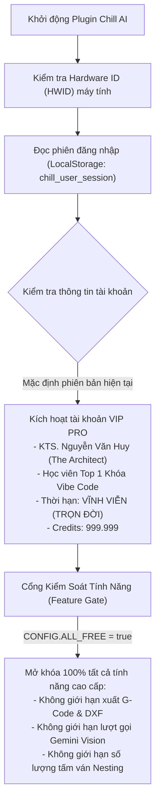
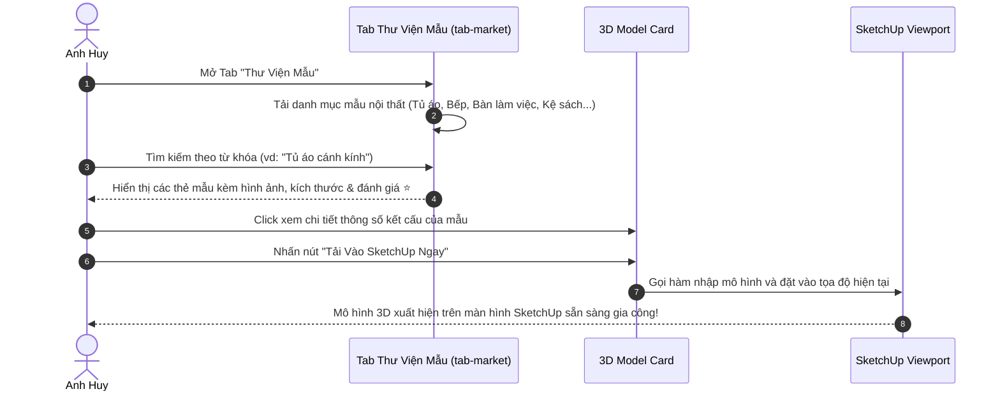

# 🛒 TÀI LIỆU 06: TÀI KHOẢN BẢN QUYỀN, CHỢ SỐ MARKETPLACE & TRA CỨU VẬT TƯ
### Chill AI Interior - Trợ Lý Thiết Kế 3D & Sản Xuất CNC
**Tổng Công Trình Sư:** Anh Huy (The Architect)  
**Tác giả tài liệu:** Lan (Trợ lý AI đồng hành)

---

## 1. HỆ THỐNG QUẢN LÝ TÀI KHOẢN & BẢN QUYỀN (CHILLAUTH LICENSING)

Được triển khai trong tệp `account.js`, hệ thống được mô phỏng theo mô hình thương mại hóa của các phần mềm gia công gỗ hàng đầu như **ABF**, **One Click Cabinet**, và **Unitool**:

### Các thông số tài khoản mẫu:
* **Họ và tên:** KTS. Nguyễn Văn Huy
* **Chức danh:** Tổng Công Trình Sư (The Architect)
* **Cấp bậc bản quyền:** `VIP_PRO` (Gói Doanh Nhân Cao Cấp)
* **Mã định danh thiết bị (Hardware Fingerprint):** Tự động sinh chuỗi nhận diện duy nhất `HWID-XXXX-XXXX-XXXX` gắn chặt với máy tính của anh Huy để chống sao chép bản quyền trái phép.
* **Huy hiệu hiển thị:** Huy hiệu vàng `👑 VIP PRO` trên thanh Top Bar ở cả 2 chế độ Studio và Khay Đứng.
* **Hộp thoại Quản lý Bản quyền (Account Modal):** Cho phép xem ngày hết hạn, số dư Credits, nạp mã bản quyền (License Key) và đổi vai trò người dùng (KTS thiết kế, Chủ xưởng gia công, Thợ DIY).

---

## 2. CHỢ SỐ THIẾT KẾ NỘI THẤT (MARKETPLACE - TAB `tab-market`)

Marketplace đóng vai trò như một thư viện số chia sẻ và thương mại hóa các mẫu thiết kế 3D đã được chuẩn hóa kỹ thuật cho Trimble SketchUp:

### Các tính năng chính của Marketplace:
1. **Bộ lọc danh mục đa dạng:**
   - Phòng khách: Sofa module, Kệ tivi treo tường, Tủ giày thông minh có ghế ngồi.
   - Phòng ngủ: Tủ áo cánh lùa, Giường bọc nệm có ngăn kéo dưới, Bàn trang điểm treo.
   - Bếp & Ăn: Tủ bếp module chuẩn kích thước chậu rửa, Bàn ăn kéo dài thông minh.
   - Văn phòng: Bàn làm việc chữ L công thái học, Kệ tài liệu chịu lực.
2. **Thông số kỹ thuật minh bạch:** Mỗi mẫu trong thư viện đều ghi rõ: Kích thước phủ bì, Loại ván kiến nghị (17.5mm), Số lượng tấm ván sau khi bóc tách, và Tỉ lệ ván hao hụt ước tính.
3. **Cơ chế Đóng Góp Mẫu (Upload to Market):** Cho phép KTS xuất các mô hình mình vừa vẽ trong SketchUp lên chợ số để chia sẻ cho cộng đồng hoặc bán lấy tiền bản quyền.

---

## 3. TAB TRA CỨU & ĐẶT MUA VẬT TƯ NGŨ KIM (`tab-shopee`)

Khi bóc tách một chiếc tủ áo hoặc tủ bếp, hệ thống không chỉ tính diện tích gỗ mà còn **tự động liệt kê danh mục phụ kiện kim khí (Hardware Bill of Materials - BOM)** và cung cấp liên kết đặt mua nhanh:

| Loại Phụ Kiện | Quy Cách Kỹ Thuật | Thương Hiệu Tương Thích | Ứng Dụng Trong Mô Hình |
| :--- | :--- | :--- | :--- |
| **Bản lề bật giảm chấn** | Trùm ngoài (Thẳng) / Trùm nửa (Cong vừa) / Lọt lòng (Cong nhiều), Ø35mm | Hafele, Blum, DTC, Ivan | Gắn cánh tủ áo, cánh tủ bếp |
| **Ray trượt ngăn kéo** | Ray bi 3 tầng giảm chấn, bản 45mm, chiều dài 350mm - 500mm (hở 12.7mm) | Hafele, Ivan, NewEra | Gắn hộc kéo tủ bàn, tủ áo |
| **Tay nắm cửa** | Tay nắm nhôm chữ U âm cánh, tay nắm núm tròn đúc đặc | Nhôm định hình xước mờ | Cánh tủ hiện đại phẳng chỉ |
| **Liên kết cam chốt** | Ốc cam liên kết chốt đúc Ø15mm + chốt thép M6x32mm | DTC, Hafele | Giấu vít liên kết hồi và đáy |
| **Chốt đợt di động** | Chốt đỡ đợt bọc cao su chống trượt Ø5mm | Phổ thông | Nâng hạ đợt tủ linh hoạt |
| **Chỉ nẹp dán cạnh** | Nẹp nhựa PVC dày 1.0mm (mặt tiền) và 0.4mm (mặt hậu/đáy), rộng 21mm/28mm | An Cường, Ba Thanh | Dán mép ván chống ẩm |

* **Nút bấm đặt hàng 1-chạm:** Khi click vào nút **"🛍️ Mua Vật Tư"**, hệ thống mở trực tiếp bảng vật tư kèm đường link chuyển hướng đến nhà cung cấp hoặc sàn thương mại điện tử với đúng số lượng và kích thước đã bóc tách từ mô hình đang chọn.

---

## 4. MODULE LƯU TRỮ DỰ ÁN & LỊCH SỬ THIẾT KẾ (PROJECT MANAGEMENT)
* **Nút Save/Load Dự Án trên Top Bar (`btn-open-projects`):**
  - Lưu toàn bộ thông số thiết kế, kích thước tùy chỉnh, cấu hình dao cắt CAM và lịch sử trò chuyện với AI vào cơ sở dữ liệu cục bộ (`localStorage` & tệp dự án).
  - Cho phép KTS lưu nhiều phương án thiết kế cho cùng một căn phòng (Phương án 1: Gỗ Sồi chân sắt; Phương án 2: Melamine trắng toàn bộ).
  - Tải lại dự án bất cứ lúc nào chỉ với một cú click chuột, tự động khôi phục góc nhìn 3D và trạng thái các tab.
