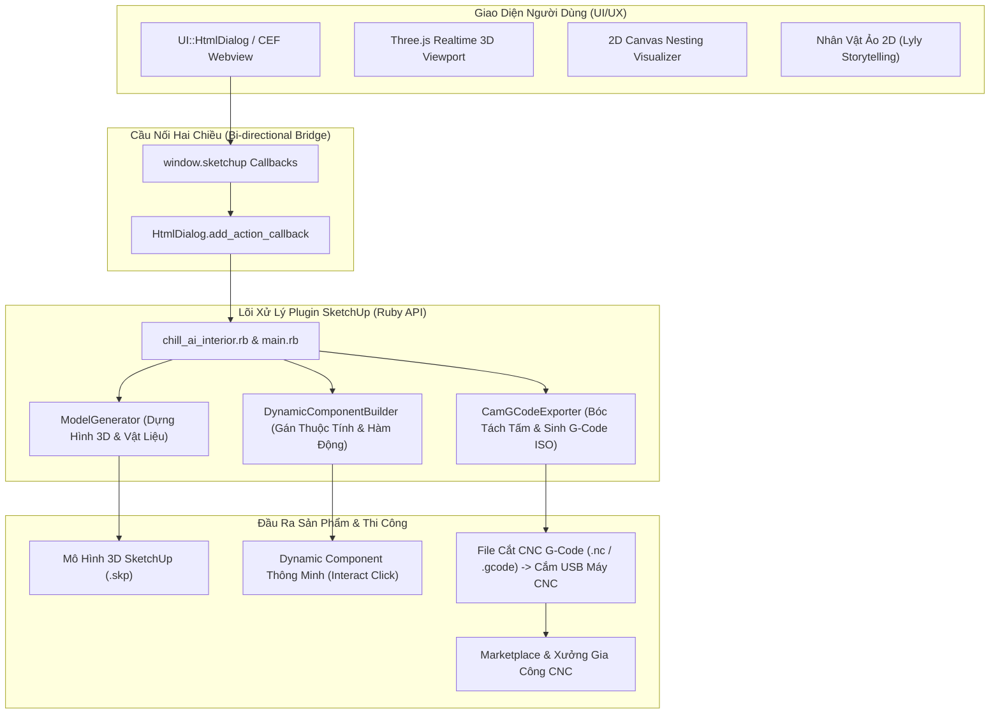
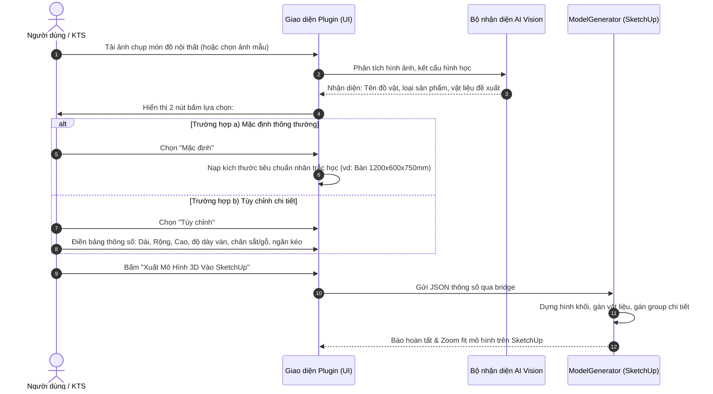
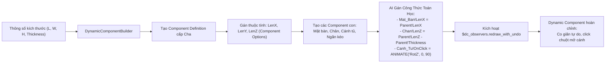
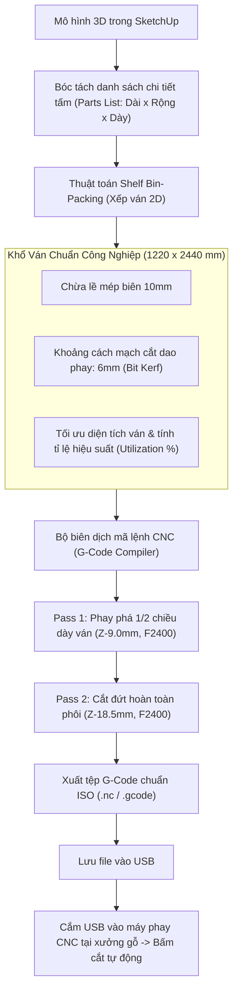
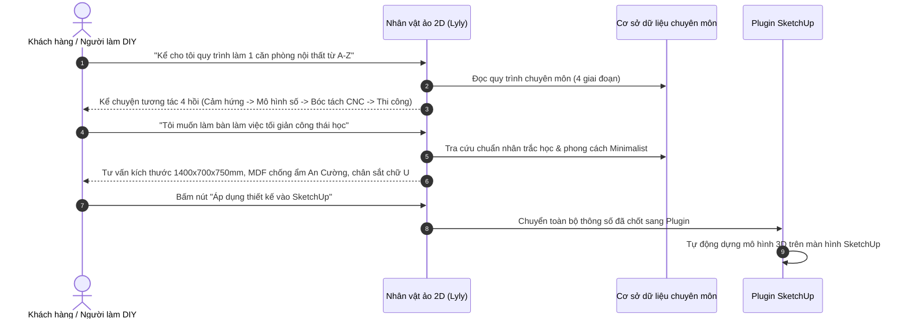

# KIẾN TRÚC HỆ THỐNG & LUỒNG QUY TRÌNH (FLOWS)
## PLUGIN SKETCHUP AI & HỆ SINH THÁI NỘI THẤT CHILL DECOR

Tài liệu này mô tả chi tiết kiến trúc kỹ thuật và các luồng quy trình vận hành chính của hệ thống Plugin AI tích hợp trên Trimble SketchUp.

---

### 1. KIẾN TRÚC TỔNG THỂ (SYSTEM ARCHITECTURE)

---

### 2. LUỒNG 1: QUÉT ẢNH TẠO 3D & 2 NÚT LỰA CHỌN KÍCH THƯỚC

---

### 3. LUỒNG 2: SINH HÀM DYNAMIC COMPONENT TỰ ĐỘNG

---

### 4. LUỒNG 3: BÓC TÁCH 2D NESTING & XUẤT FILE G-CODE CẮM USB MÁY CNC

---

### 5. LUỒNG 4: TRỢ LÝ ẢO 2D KỂ CHUYỆN & TƯ VẤN NỘI THẤT

